# NovelDB

**[App website](https://shirochi-stack.github.io/NovelDB/apps/)** (desktop and mobile apps, screenshots, downloads) · **[NovelDB database](https://shirochi-stack.github.io/NovelDB/)**

NovelDB downloads web novels and comics from npia and 1,000+ other sites as EPUB, TXT, PDF or CBZ. Search every site from one catalog, queue whole series, and read what you saved in a built-in library. It runs on Windows, macOS and Linux, with native apps for Android and iOS.

  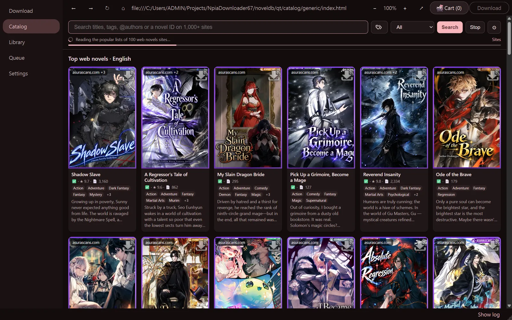

-----

## 📚 Table of Contents

  - [✨ Features](#-features)
  - [📸 Screenshots](#-screenshots)
  - [🌐 NovelDB Metadata Website](#-noveldb-metadata-website)
  - [🧩 Site Engines](#-site-engines)
  - [💻 Desktop Downloads](#-desktop-downloads)
  - [🚀 Usage](#-usage)
  - [💾 Space-Saving Tips](#-space-saving-tips)
  - [🛠️ Command-Line Arguments](#️-command-line-arguments)
  - [❓ FAQ (Frequently Asked Questions)](#-faq-frequently-asked-questions)
  - [📜 Legal & Disclaimer](#-legal--disclaimer)

-----

## ✨ Features

  - **Catalog:** search titles, tags, authors or a novel ID on 1,000+ sites at once, with NovelDB's own index first; the same book from several sites shows as one card.
  - **Downloads from many sources:** npia, kpage, sfc, nweb, mpia, jara, rbooks, nseries, qdn and more through built-in scrapers, plus lightnovel-crawler, FanFicFare, LNReader plugins and a generic engine for other sites.
  - **Queue:** add links or whole series, pick formats and chapter ranges, and let the queue work through them with retries.
  - **Library and reader:** read saved books (and books straight from the Catalog) in a paged or scrolling reader with themes, fonts and comic layouts.
  - **Your logins:** sign in once with Enter Browser; downloads and the Catalog use the saved sessions, so books you own download too.
  - **Rich metadata and formatting:** tags, authors, synopses and covers go into the EPUB, with the original formatting, author notices and illustrations kept.
  - **Small files:** WebP / AVIF / PNG / JPEG image compression shrinks books a lot without a visible loss. (AVIF needs the optional `pillow-avif-plugin` package; see `requirements.txt`.)
  - **Mobile apps:** Android and iOS share the Catalog, sources and settings with the desktop; settings files import across all three.
  - **Command line:** scripted and bulk downloads for automation.

-----

## 📸 Screenshots

| Download | Library | Reader |
| :---: | :---: | :---: |
| 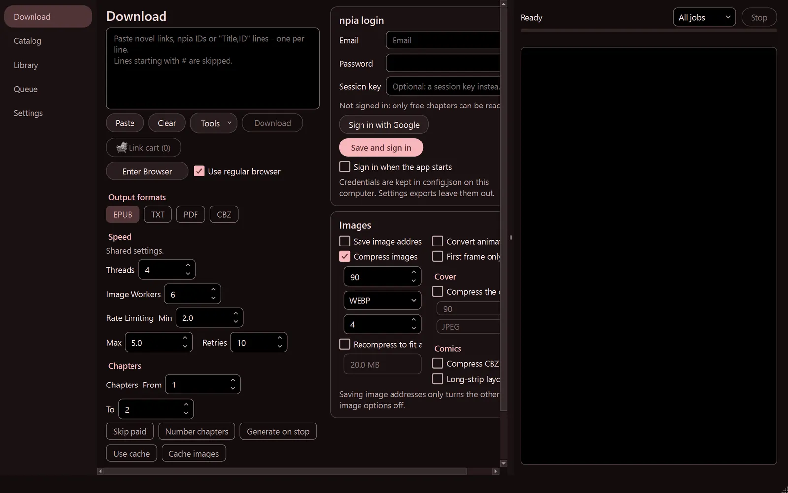 | 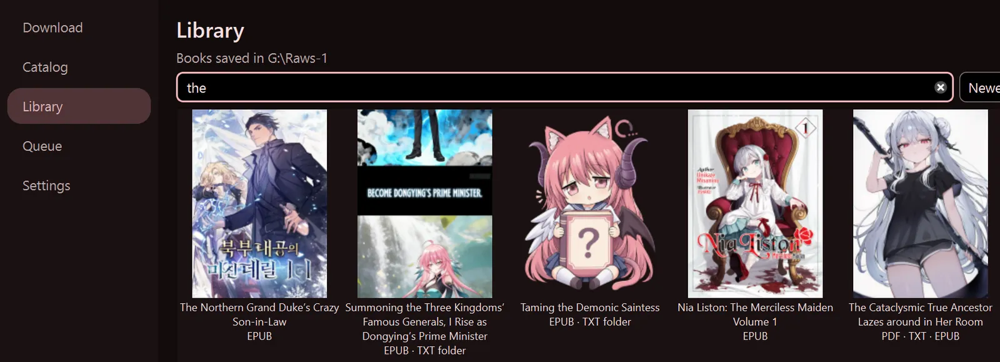 | 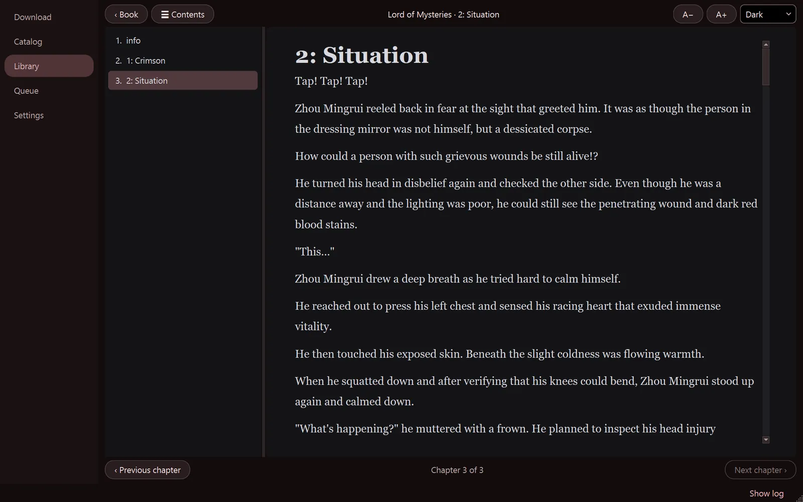 |
| **Queue** | **Book details** | **Settings** |
| 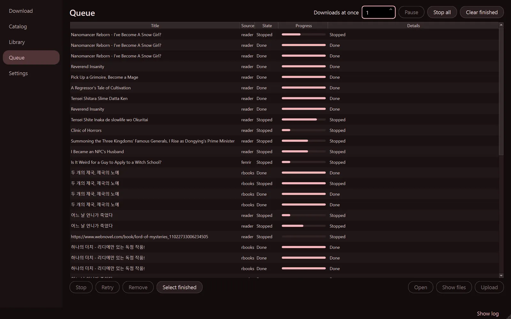 | 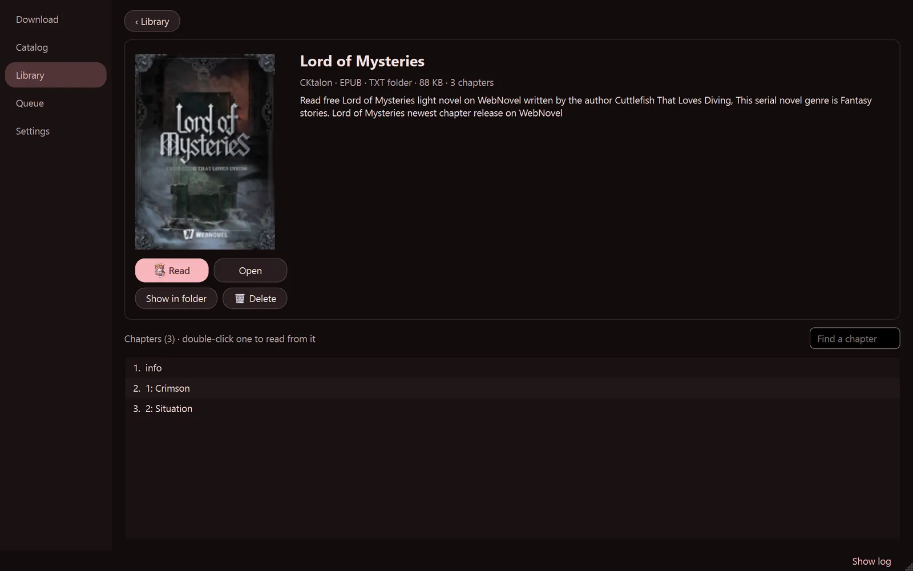 | 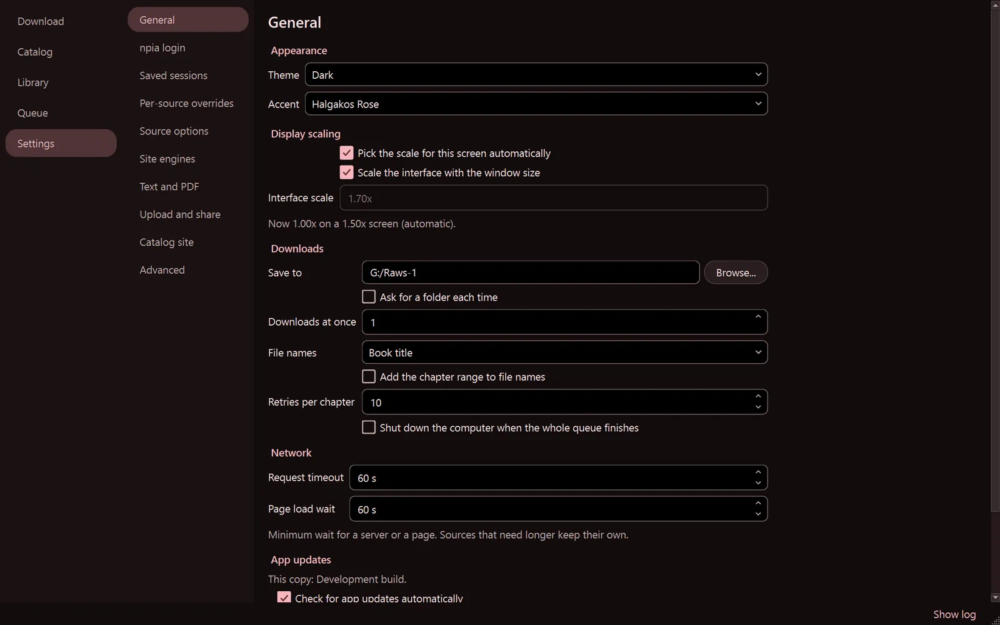 |

| Android Catalog | Book details | Reader | Add links |
| :---: | :---: | :---: | :---: |
| 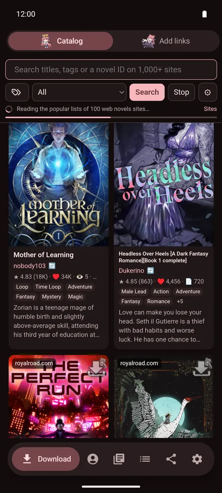 | 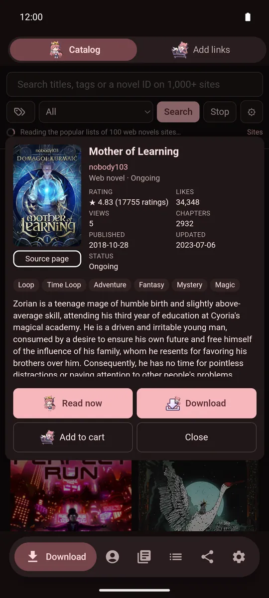 | 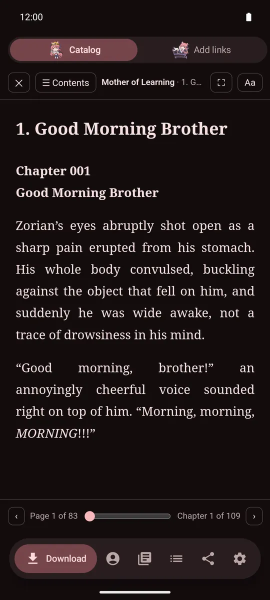 | 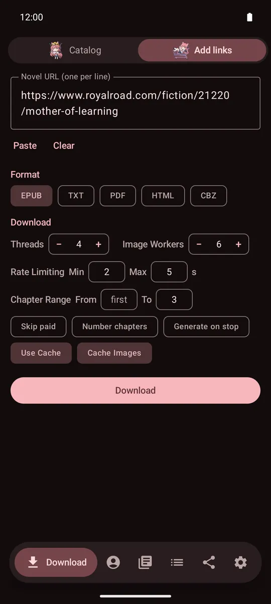 |

More on the [app website](https://shirochi-stack.github.io/NovelDB/apps/).

-----

## 🌐 NovelDB Metadata Website

This repository also contains **NovelDB**, a static search website in `docs/`. Its metadata pipeline supports Npia, Kpage, SFC, Nweb, Mpia, Jara, Rbooks, and Nseries. Users search and filter listings, read synopses, and follow links to the original platforms. New sources become selectable when their validated catalogs are published.

Rbooks uses a fresh browser-compatible HTTP session for its public API. Live checks collected 480 novels with synopses and verified all four webnovel genres. Its category API limits offsets to below 6,000, so larger catalogs remain explicitly partial. Jara latest-list scans now use persistent continuation cursors, verified past the old page-101 failure. Resume migrates old checkpoints while preserving saved novels and translations.

- [Metadata pipeline and script reference](docs/metadata-pipeline.md): discovery, field schemas, historical records, translations, website loading, batch entry points, and scheduled workflows.
- [Nweb, Mpia, Jara, and Rbooks integration](docs/metadata-source-expansion.md): implemented anonymous collectors, commands, durable history, translation/build stages, workflows, tests, and full-crawl limitations.

For a bounded staged sample, run `python scripts/metadata_pipeline.py run --source nweb --mode sample --output-dir .cache/nweb-sample --state-dir .cache/nweb-state` (also supports `mpia`, `jara`, and `rbooks`). Add `--dry-run` for zero requests and zero writes. Collection and local builds do not publish; translation and promotion are explicit operations. Implementation verification used anonymous samples and mocked translation, with existing production data unchanged.

**Translation setup:** add `OPENAI_API_KEY` under GitHub **Settings → Secrets and variables → Actions → New repository secret**. All eight sources now default to `gpt-6-luna`; set `ANTHROPIC_API_KEY` too if you run with a `claude-*` model override; existing English is retained and only missing/changed originals enter the queue. Explicit provider/model overrides remain supported.

For Nweb, Mpia, Jara, and Rbooks, choose **catalog** to collect/resume discovery and details, **rankings** for native boards, **build** to repackage saved state, or **resume** to continue saved collection. Catalog runs discover listings before detail enrichment, use four continuously refilled detail workers by default, and save every 60 seconds or 500 changed records plus phase boundaries. A five-hour budget is a resumable limit, not a claim of full coverage. With **auto_continue** enabled (default), a progressing budget-limited catalog is queued again after the translation attempt; failures, coverage limitations, cancellation, and no progress stop the chain. See the integration guide for recovery and coverage meanings.

The website preserves cards and covers while chunks arrive. **Load Synopsis** defaults on and persists across refreshes; turn it off to skip synopsis shards and description-bearing top bundles. Nweb, Mpia, Jara, and Rbooks still use `.json.gz` catalog chunks, gzip corpora/top bundles, and 128 compressed synopsis shards per source.

Nseries (`nseries`) is a separate source with public R19 listing metadata. Full adult details require verification; available catalog text is labelled as a synopsis preview. See the integration guide for tested R19 support and limitations.

The website metadata pipeline is separate from the desktop novel downloader described below.

-----

## 🧩 Site Engines

A link pasted into **Download** (or a book picked in the Catalog) is read by a *site engine*: code that knows how to find a site's book page, chapter list and chapter text. NovelDB ships with nine, tried in this order until one returns chapters:

| # | Engine | What it covers |
| :-: | --- | --- |
| 1 | **Built-in scrapers** | The app's own code for the sites it knows best: npia (Korean and Global), kpage, sfc, nweb, mpia, jara, rbooks, nseries, qdn, floo and others. Handles logins, purchased chapters and each site's protections. |
| 2 | **novel-downloader rules** | The [novel-downloader](https://github.com/404-novel-project/novel-downloader) rule set, mostly Chinese and Japanese sites. |
| 3 | **WebToEpub parsers** | [WebToEpub](https://github.com/dteviot/WebToEpub)'s 650+ parsers, mostly English translation sites. |
| 4 | **lightnovel-crawler sources** | [lightnovel-crawler](https://github.com/lncrawl/lightnovel-crawler)'s sources, many languages. |
| 5 | **LNReader plugins** | [LNReader](https://github.com/LNReader/lnreader-plugins)'s plugins; they also power part of the Catalog search. |
| 6 | **FanFicFare adapters** | [FanFicFare](https://github.com/JimmXinu/FanFicFare)'s adapters for fan-fiction archives. |
| 7 | **HaruNeko websites** | [HaruNeko](https://github.com/manga-download/haruneko)'s manga and webtoon sites. |
| 8 | **gallery-dl extractors** | [gallery-dl](https://github.com/mikf/gallery-dl)'s extractors, for image-based comics. |
| 9 | **Generic fallback** | Reads any other site: finds the chapter list (following its pages, "load more" lists and app page data) and each chapter's main text, in a real browser when the site needs one. |

### How an engine is chosen

With **Dynamic priority** on (the default), a link only tries the engines that list its site, in the order above, and then the generic fallback. The log says which one it picked, for example `Dynamic priority: trying Generic fallback (7 other engine(s) don't list this site)`. With it off, every engine is tried in turn.

When a built-in scraper owns a site, the other engines follow only if they list that site too, so a clear failure (a DRM-only book, a missing sign-in) is reported without extra attempts.

**Settings › Site engines** lets you drag the engines into another order, untick one to skip it, and add your own: **Add custom engine** loads a Python file with an `Engine` class (`label`, `sites`, `parse_book`, `parse_chapter`; see `noveldb/core/engines/custom_engines.py`). A custom engine goes just before the generic fallback.

### Logins and browsers

Sites that need an account use your own sessions. Sign in once with **Enter Browser** (an installed-Chrome window with the downloader's own profile) and downloads, the Catalog and its reader reuse those cookies. Books you own or have rented download too; chapters you can't read are reported as locked. If the profile is already open in another window, the app closes it first, saving the session cookies.

A few built-in scrapers worth knowing about:

- **jara, nweb, nseries** use direct HTTP requests, no browser. jara downloads free chapters without an account, and purchased and adult ones after you sign in. nweb is free; adult works need a signed-in account. nseries books are resolved to their nweb edition when the product page links one.
- **Global npia** uses the site's API directly; a saved login is turned into the API credential before chapter 1.
- **rbooks** covers serialized webnovels and owned volume ebooks. A volume its web viewer refuses is read through the official rbooks PC viewer (install it first). If rbooks asks for verification, open the link with **Enter Browser**, complete it, close the window and retry.
- **qdn** decodes its cipher-font chapters from a fixed outline table of the characters (`data/qdn_outline_table.json`) and refuses to save a chapter it can't decode.

Each chapter waits a random delay between **Min** and **Max** interval; set both to the same value for a fixed delay.

### Updating the engines

The bundled engines ship with the app and also update themselves: each has its own **Update … automatically**
box in Settings › Site engines (all on by default). The app then checks once a day for a newer
build in this repository's [`engines` release](https://github.com/Shirochi-stack/NovelDB/releases/tag/engines),
which the **Engine Updates** workflow rebuilds daily from the official repositories and only
publishes once the new bundle loads. Downloads are checked against their SHA-256, and a
build that fails to load in the app is set aside for the shipped copy.

To rebuild the shipped copies yourself:

- `update_rules.bat` (or `python scripts/update_nd_rules.py --validate`) clones novel-downloader,
  applies the bridge-mode patch, builds it with webpack and writes `rules-lib.js`. Needs git,
  Node.js and npm.
- `python scripts/update_webtoepub.py --validate` packs WebToEpub's parsers into
  `webtoepub/webtoepub-lib.js`, between `scripts/webtoepub/prefix.js` (extension API stand-ins
  and the network transport) and `scripts/webtoepub/bridge.js` (the app's entry points).

-----

## 💻 Desktop Downloads

Each release has three builds for Windows, macOS and Linux. Every build has the same app: Download, Catalog, Queue and Settings pages, a link cart and cloud uploads.

| Build | What it includes | Pick it when |
|---|---|---|
| **Full** | A bundled Chromium (for browser-based sources and Enter Browser), plus the embedded Catalog | You want every source to work |
| **Lite** | The embedded Catalog and Google sign-in, but no bundled Chromium | You only use sources that need no browser |
| **TurboLite** | No browser engine at all; the Catalog opens in your own browser | You want the smallest, fastest download |

| OS | Files | Notes |
|---|---|---|
| Windows 10/11 (64-bit) | `NovelDB98-windows-x86_64.exe` (single file), `NovelDB98-windows-x86_64.zip` (Full as a folder: starts faster), `NovelDB98_Lite-…exe`, `NovelDB98_TurboLite-…exe` | SmartScreen may warn about an unknown publisher: choose **More info → Run anyway**. The single-file Full build unpacks itself on every start, so the zip starts faster. |
| macOS 13+ (Apple silicon `arm64`, Intel `x86_64`) | `NovelDB98-macos-arm64.dmg` and the `_Lite` / `_TurboLite` DMGs | Drag the app to Applications. The app is not notarised: the first time, right-click it and choose **Open** (or allow it in System Settings → Privacy & Security). |
| Linux x86_64 (glibc 2.35+, e.g. Ubuntu 22.04+) | `NovelDB98-linux-x86_64.AppImage` and the `_Lite` / `_TurboLite` AppImages | `chmod +x` the file and run it. AppImages need FUSE 2 (`libfuse2`, called `libfuse2t64` on Ubuntu 24.04) or `--appimage-extract-and-run`. The embedded Catalog runs without Chromium's sandbox inside an AppImage. |

Settings live in `config.json` next to the app. When that folder can't be written to (a macOS `.app`, a Linux install), they go to the per-user folder instead: `%LOCALAPPDATA%/NovelDB` on Windows, `~/Library/Application Support/NovelDB` on macOS, `~/.config/NovelDB` on Linux. A `SHA256SUMS-<os>.txt` file in each release lists the checksums.

### App updates

The desktop, Android and iOS apps update themselves from these releases. **Check for app updates automatically** (Settings › General on desktop; Settings on mobile) is on by default: once a day the app reads `update-<platform>.json` from the latest release (`update-windows.json`, `update-macos.json`, `update-linux.json`, `update-android.json`, `update-ios.json`). The release workflows write it, listing every file with its build number, size and SHA-256. When a newer build of your variant exists, the app offers it. It downloads only when you choose **Update**, and installs only when the download's size and SHA-256 match the manifest.

- **Windows:** the `.exe` (or the folder from the `.zip`) is replaced in place after NovelDB quits, and the new copy starts. `config.json` next to it stays.
- **macOS:** the `.app` is replaced in place. This doesn't work from the disk image or a translocated copy; move NovelDB to Applications first.
- **Linux:** the AppImage file is replaced.
- **Android:** the system installer asks you to confirm. Android refuses an APK signed with a different key; that only happens with builds older than v97.
- **iOS:** an app can't install itself, so the verified IPA is offered to the share sheet (for SideStore, AltStore and similar tools) or saved to Files.

Builds made outside the release workflows (from source, local builds) are development builds and never offer updates. Set `NOVELDB_UPDATE_BASE` to point the desktop app at another copy of the releases when testing.

To run from source, install `requirements-full.txt` (or `-webengine` / `-gui` for Lite / TurboLite), then run `python noveldb_app.py`. To build, run `python scripts/build_desktop.py --variant full --package` (or `build.bat` on Windows).

-----

## 🚀 Usage

To download paid chapters, you'll need a `LOGINKEY`. You can get it by logging into your Npia account in a web browser, opening the developer tools (F12), and navigating to the **Storage** tab. Copy the value of your `LOGINKEY` from there.
*(You must have access to the content that you intend to download on your account.)*

A higher thread count and a lower interval can speed up your downloads, but be aware that this increases the risk of an IP ban.
*(Going above 10 threads can cause the website to rate-limit you, resulting in chapters failing to download and eventually a 24-48 hour IP ban.)*

-----

## 💾 Space-Saving Tips

### Image Compression

Built-in image compression can dramatically reduce file size. Use the `-compressimages` and `-jpegquality` arguments to enable this feature. (Or the checkbox)
**Image Compression Workers** only controls concurrent image compression; chapter scraping still uses **Threads**.

  - **80% Quality:** Provides large savings with no noticeable quality difference (e.g., 1MB -\> 65KB).
  - **50% Quality:** Offers massive savings with only a small difference in quality (e.g., 1MB -\> 30KB).
  - **10-30% Quality:** For extreme savings, though the quality difference will be noticeable (e.g., 1MB -\> \<10KB).

### Post-Processing with Calibre

For even greater space savings (10-50%), you can use the Calibre EPUB editor. Converting and saving a new `.epub` file with Calibre optimizes the CSS, HTML, and embedded fonts. This is a manual step, as implementing these optimizations directly is currently outside the scope of this project.

-----

## 📦 Batch Download / Paste Batch (GUI)

Two sibling buttons feed the same sequential batch engine:

- **Batch Download** — pick a list file (`.txt` / `.csv`).
- **Paste Batch** — paste the list directly into a dialog window (no file needed).

Both accept the same line formats, one entry per line:

- `NovelID`
- `SOURCE_URL` (URL auto-resolved)
- `Title,NovelID` — the title is used in the output filename.
- `Title,SOURCE_URL`
- `# comment` — any line beginning with `#` is skipped.

The main **Novel ID / URL** field in the single-download form also accepts a full Npia URL — it's resolved to the numeric ID automatically and written back into the field.

**How it works:**

1. Click **Batch Download** (and pick a list file) or **Paste Batch** (and paste entries).
2. If **Quick Download** is enabled, its folder is used as the output directory. Otherwise you'll be prompted for one.
3. Every novel is downloaded with the **current UI settings** — selected format(s) (any combination of EPUB/TXT/PDF), chapter range, compression, image format (WEBP/JPEG/PNG/**AVIF**), cover format, notices, cache, threads, image compression workers, and interval. Configure these **before** pressing the button.
4. Blank lines, `#` comments, and entries that cannot be resolved to a numeric ID are skipped. A 2 second pause is inserted between novels to reduce server load.
5. Pressing **Stop** cancels the batch — the current novel finishes, then the run exits.
6. Each novel is saved as `[<id>] <title>.<ext>` in the chosen folder, with one file per selected format. A final `OK / Failed / Skipped` summary is logged.

**Tip:** you can generate a batch list automatically from **Tag Retrieval** (by tag or Top 100), then feed that file straight into Batch Download, or copy its contents into Paste Batch. An in-app help dialog is also available via the **?** button next to **Batch Download**.

### Image format notes

- The **Format** dropdown under *Compress Images* controls the output format for chapter images.
- **GIFs are preserved as `.gif` by default** so that animation is kept. If you'd rather have GIFs re-encoded to the selected format (WEBP/JPEG/PNG/AVIF, first frame only), tick the **Convert GIFs** checkbox next to the format dropdown. The toggle state is saved automatically to `config.json` (`convert_gifs`).
- The same Format dropdown applies to the cover image via *Compress Cover* → **Format**.
- Selecting **AVIF** requires `pillow-avif-plugin` to be installed; otherwise the downloader automatically falls back to WEBP with a warning in the log.

-----

## 🛠️ Command-Line Arguments

NovelDB can be operated directly from the command line, ideal for automated and scripted downloads.

*(Keep the table of arguments and usage examples exactly as you have them, they are very clear and well-formatted.)*

-----

## ❓ FAQ (Frequently Asked Questions)

Here are some solutions to common problems you might encounter.

**Q: I'm getting an error that says I'm not logged in, but I've entered my LOGINKEY.**
A: Ensure your `LOGINKEY` is still valid. Npia keys expire after a period of time. Try logging out and back in on the website, then get a new `LOGINKEY` from the storage tab and use that. Make sure you click the "Log In" button in the application.

**Q: The download process seems to be stuck or is extremely slow.**
A: This could be due to a temporary IP ban from Npia's servers, which can happen with a high thread count. Try the following:

1.  Reduce your thread count and increase the interval in the settings.
2.  If the problem persists, wait for a few hours and try again, as the IP ban is usually temporary.
3.  Check your network connection.

**Q: The downloaded file is missing chapters or content.**
A: Double-check the `-from` and `-to` arguments to make sure they cover the desired chapter range. Ensure you have a valid `LOGINKEY` for any paid chapters. Lastly, make sure your account has access to the content you are downloading.

**Q: How do I find the `Novel ID`?**
A: The `Novel ID` is the number in the novel's URL. For example, if the URL is `SOURCE_URL`, the `Novel ID` is `123456`.

**Q: My EPUB reader is throwing errors when I try to open the EPUB.**
A: This can be caused by missing chapters (e.g., R19 chapters being skipped due to account permissions). The easiest fix is to open the EPUB in [Calibre](https://calibre-ebook.com/download) (an open-source e-book & EPUB manager) and convert it to a new EPUB file. This can be done in bulk.

**Q: Epub fails to load still**
A: Use Moon+ Reader, ReadEra, or Calibre. Lithium and some other readers may not work, but this will be fixed in a future update.

-----

## 📜 Legal & Disclaimer

This project is a fork of CjangCjengh's NpiaDownloader and is intended for personal use to create backups of content you have legally accessed. I am not affiliated with Npia. Please respect their terms of service and copyright laws.

### Credits

- **[novel-downloader](https://github.com/404-novel-project/novel-downloader)** by [404-novel-project](https://github.com/404-novel-project) — Powers the external novel download feature with support for 100+ sites.
- **[WebToEpub](https://github.com/dteviot/WebToEpub)** by David Teviotdale and contributors (GPL-3.0) — Its site parsers are the third site engine; the bundle and its licence are in `webtoepub/`.
- **[NTKDownloader](https://github.com/tyuop077/NTKDownloader/tree/main)** by [tyuop077](https://github.com/tyuop077) — Reference implementation for the NewToki `curl_cffi` Chrome impersonation, `nv` issue flow, HMAC-signed `/api/novel-content` requests, and payload decryption approach used by this project.
- **Razure** — Contributed the `rbooks-dl` Chrome extension whose episode discovery, metadata, viewer cleanup, paywall detection, and image handling power the native Rbooks external scraper.
- **[CjangCjengh/NpiaDownloader](https://github.com/CjangCjengh/NpiaDownloader)** — Original Npia downloader this project is forked from.

-----
